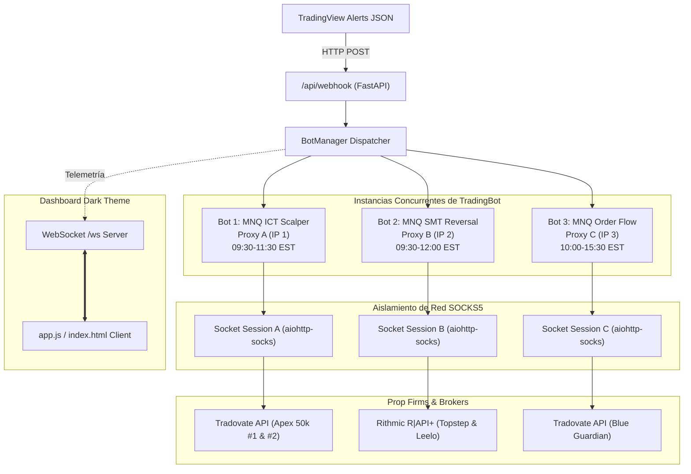

# Arquitectura conceptual de QUANTUM FX

> **Estado: arquitectura conceptual.** Es una referencia de diseño; valida cada componente en el mapa y el estado técnico antes de asumir que existe.

> **Estado y alcance:** este documento contiene una descripción conceptual y objetivos del diseño; algunos conectores y flujos del diagrama no equivalen a integraciones activas. Para conocer las dependencias realmente declaradas, las ubicaciones actuales y el estado implementado, consulta [[documentacion/02_ESTADO_TECNICO_Y_SALUD|Mapa del sistema, stack y salud]], [[documentacion/01_MAPA_DEL_PROYECTO|Mapa del código]] y [[../README|README operativo]]. El código y las pruebas prevalecen sobre los diagramas de diseño.

## Resumen Ejecutivo
**QUANTUM FX** es una infraestructura de trading algorítmico distribuido para futuros de CME (**Micro E-mini Nasdaq-100 / MNQ**), concebida para ejecutarse como un servicio nativo de alta disponibilidad en **Windows**.

El sistema desacopla completamente tres dimensiones críticas:
1. **La Estrategia Algorítmica**: Módulos técnicos puros (`ICTStrategy`, `SMTStrategy`, `OrderFlowStrategy`) que reciben señales de TradingView y deciden entrada, stop loss y take profit según las condiciones del mercado.
2. **El Aislamiento de Red**: Cada bot encamina sus sockets HTTP/WebSocket exclusivamente por su propio proxy SOCKS5 dedicado (`aiohttp-socks`), garantizando que la IP de la máquina Windows anfitriona no se vea afectada.
3. **La Replicación de Cuentas**: Cada bot replica simultáneamente las órdenes aprobadas a través de su túnel de red hacia múltiples cuentas de prop firms (Apex, Topstep, Leelo, Blue Guardian) conectadas vía **Tradovate** y **Rithmic**.

---

## Componentes del Código y Responsabilidades

- **`fastapi_service/main.py`**:
  - Servicio FastAPI opcional, separado del servidor Node principal.
  - Publica su propia API y WebSocket; sus rutas no son intercambiables con las de Node.
  - Comparte SQLite, pero el shell Electron no lo inicia.

- **`fastapi_service/bot_engine.py`**:
  - Gestiona bots y cuentas en modo simulado.
  - Comparte el estado con `fastapi_service/persistence.py`; las rutas de estrategia están en `fastapi_service/strategies.py`.
  - La presencia de clases de proxy o de documentación de brokers no demuestra una integración activa.

- **`fastapi_service/strategies.py`**:
  - Jerarquía orientada a objetos derivada de `BaseStrategy`.
  - Normalización y cálculo de Stop Loss / Take Profit / R:R.

- **`src/server/server.js` y `public/` (panel principal)**:
  - Estética **Dark Theme estricto** (#0D0D0D, #121212, #181818, #1E1E1E).
  - Grid reactivo con tarjetas por bot, panel de detalle con consola de eventos en streaming y tabla de cuentas con nombres personalizados.

---

## Enlaces Relacionados
- [[documentacion/00_INICIO_OBSIDIAN|Índice Maestro de la Wiki]]
- [[documentacion/01_MAPA_DEL_PROYECTO|Mapa del código y Obsidian]]
- [[README|Guía Operativa y Ejecución Local]]
- [[documentacion/planificacion/PLAN_DE_IMPLEMENTACION|Plan de Implementación y Arquitectura]]
- [[documentacion/planificacion/TAREAS_PENDIENTES_QUANTUM_FX|Pendientes y Mejoras del Proyecto]]
- [[documentacion/conceptos/diseno-aislamiento-proxy-socks5]] — Detalles del enrutamiento de red en Windows.
- [[documentacion/conceptos/replicacion-simulada-multicuenta]] — Mecánica de replicación y cálculo de PnL.
- [[documentacion/conceptos/horarios-de-mercado-nueva-york]] — Ventanas operativas y filtrado temporal.
- [[documentacion/estrategias/referencia-estrategia-ict]] — Parámetros y lógica de la estrategia ICT.
- [[documentacion/estrategias/referencia-estrategia-smt]] — Parámetros de la estrategia SMT.
- [[documentacion/estrategias/referencia-estrategia-order-flow]] — Parámetros de la estrategia de Order Flow.
- [[documentacion/integraciones/estado-tradovate-api]] — Conector Tradovate.
- [[documentacion/integraciones/estado-rithmic-rapi]] — Conector Rithmic.
- [[documentacion/reglas_de_fondeo/referencia-reglas-apex-topstep-leelo-blueguardian]] — Matriz de compliance para prop firms.
