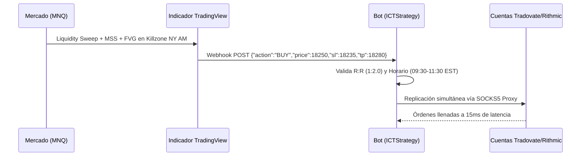

# Referencia de estrategia ICT

> **Estado: referencia estratégica.** No confirma que el motor actual ejecute esta estrategia.

## Fundamento Conceptual
La estrategia **ICT** se basa en la identificación de la huella algorítmica institucional (IPDA - Interbank Price Delivery Algorithm). Busca momentos donde el precio barre liquidez previa (Buy-side o Sell-side Liquidity) y genera un desplazamiento violento con desbalance de órdenes.

## Componentes Técnicos de Validación

1. **Liquidity Sweep (Toma de Liquidez)**: El precio penetra un máximo o mínimo clave (ej. Asian Session High/Low, Previous Day High/Low).
2. **Market Structure Shift (MSS)**: Ruptura estructural con desplazamiento y cierre de vela con cuerpo (desplazamiento con intención).
3. **Fair Value Gap (FVG)**: Formación de un desbalance de tres velas donde la mecha de la vela 1 y la vela 3 no se solapan. La entrada se busca en el retest del FVG (Consequent Encroachment / 50%).
4. **Filtro de Ratio Riesgo / Beneficio**: Exige un mínimo de $1:2.0$ de R:R.
5. **Máximo Stop Loss Permitido**: 25 puntos de MNQ ($50 USD por contrato) para proteger el trailing drawdown de cuentas de evaluación de prop firms.

## Parámetros Configurables en `fastapi_service/strategies.py`
- `min_rr_ratio`: 2.0 (por defecto)
- `max_stop_loss_points`: 25.0
- `min_stop_loss_points`: 6.0
- `default_contracts`: 1
- `max_contracts`: 4

## Enlaces Relacionados
- [[documentacion/00_INICIO_OBSIDIAN|Índice Maestro de la Wiki]]
- [[documentacion/03_ARQUITECTURA_CONCEPTUAL]]
- [[documentacion/conceptos/horarios-de-mercado-nueva-york]]
- [[documentacion/estrategias/referencia-estrategia-smt]]
- [[documentacion/reglas_de_fondeo/referencia-reglas-apex-topstep-leelo-blueguardian]]
