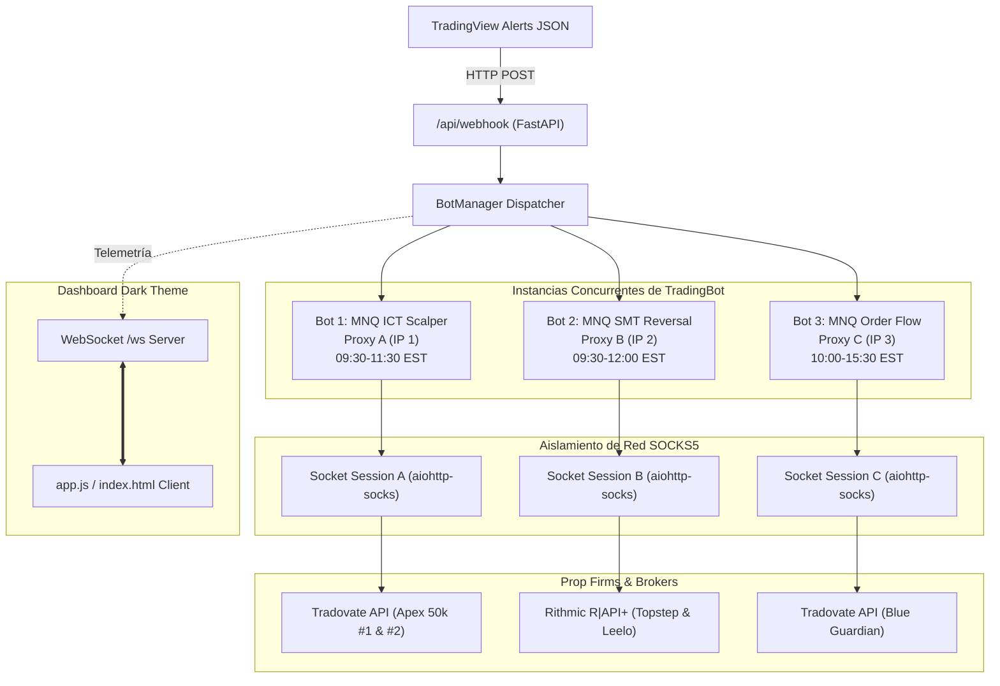

# Arquitectura General del Sistema (QUANTUM FX)

## Resumen Ejecutivo
**QUANTUM FX** es una infraestructura de trading algorítmico distribuido para futuros de CME (**Micro E-mini Nasdaq-100 / MNQ**), concebida para ejecutarse como un servicio nativo de alta disponibilidad en **Windows**.

El sistema desacopla completamente tres dimensiones críticas:
1. **La Estrategia Algorítmica**: Módulos técnicos puros (`ICTStrategy`, `SMTStrategy`, `OrderFlowStrategy`) que reciben señales de TradingView y deciden entrada, stop loss y take profit según las condiciones del mercado.
2. **El Aislamiento de Red**: Cada bot encamina sus sockets HTTP/WebSocket exclusivamente por su propio proxy SOCKS5 dedicado (`aiohttp-socks`), garantizando que la IP de la máquina Windows anfitriona no se vea afectada.
3. **La Replicación de Cuentas**: Cada bot replica simultáneamente las órdenes aprobadas a través de su túnel de red hacia múltiples cuentas de prop firms (Apex, Topstep, Leelo, Blue Guardian) conectadas vía **Tradovate** y **Rithmic**.

---

## Componentes del Código y Responsabilidades

- **`main.py`**:
  - Servidor asíncrono FastAPI y gateway HTTP/WebSocket.
  - Endpoint `/api/webhook` con validación de token secreto para procesar alertas de TradingView.
  - Endpoint `/ws` con canalización bidireccional continua (transmisión de snapshots a 1Hz y notificaciones en tiempo real).
  - API REST de control para pausar/reanudar bots, modificar ventanas de horario y añadir cuentas.
  - Servidor de archivos estáticos para la interfaz web.

- **`bot_engine.py`**:
  - `ProxyConnector`: Enrutador a nivel de socket con soporte SOCKS5 y fallback automático. Mide latencia (ping) e IP pública de salida.
  - `TradingBot`: Instancia operativa que encapsula una estrategia, un proxy y una lista de cuentas. Valida el filtro de horario de Nueva York (`America/New_York`) antes de ejecutar cualquier orden.
  - `BrokerAdapter`: Abstracción de conexión para Tradovate y Rithmic que efectúa la replicación concurrente (`asyncio.gather`) y calcula PnL en base al tick de MNQ ($0.50 USD / tick).
  - `BotManager`: Gestor central, persistencia en `config.json` y bucle de telemetría en segundo plano.

- **`strategies.py`**:
  - Jerarquía orientada a objetos derivada de `BaseStrategy`.
  - Normalización y cálculo de Stop Loss / Take Profit / R:R.

- **`public/` (UI Dashboard)**:
  - Estética **Dark Theme estricto** (#0D0D0D, #121212, #181818, #1E1E1E).
  - Grid reactivo con tarjetas por bot, panel de detalle con consola de eventos en streaming y tabla de cuentas con nombres personalizados.

---

## Enlaces Relacionados
- [[socket-level-proxy-isolation]] — Detalles del enrutamiento de red en Windows.
- [[multi-account-order-replication]] — Mecánica de replicación y cálculo de PnL.
- [[new-york-killzones-and-time-filters]] — Ventanas operativas y filtrado temporal.
- [[ict-strategy]] — Parámetros y lógica de la estrategia ICT.
- [[smt-strategy]] — Parámetros de la estrategia SMT.
- [[order-flow-strategy]] — Parámetros de la estrategia de Order Flow.
- [[tradovate-api]] — Conector Tradovate.
- [[rithmic-rapi]] — Conector Rithmic.
- [[apex-topstep-leelo-blueguardian]] — Matriz de compliance para prop firms.
